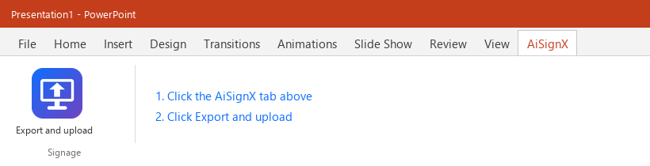
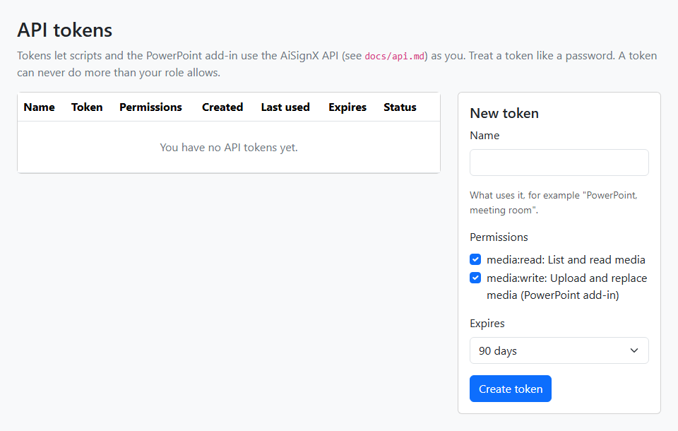
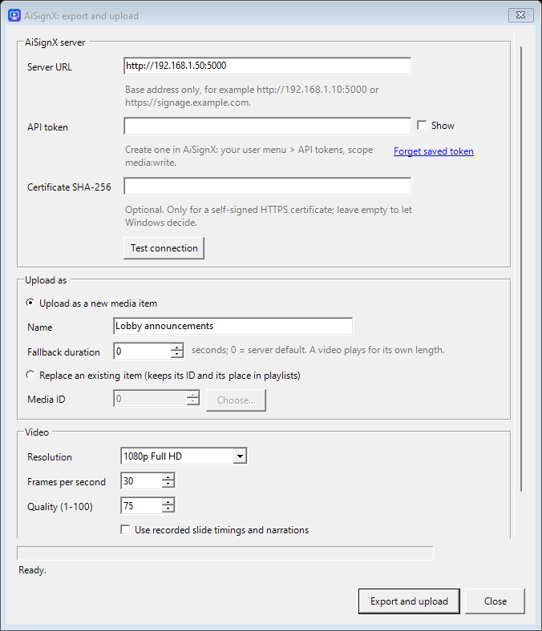

# AiSignX for PowerPoint

Turn a PowerPoint presentation into a video on your screens in two clicks. The add-in adds an
**AiSignX** tab to PowerPoint. It exports the open presentation as an MP4 video and uploads it to
your AiSignX server, either as a **new media item** or by **replacing** an item that is already in
your playlists, so the screens update by themselves.

> **Version 3.0.2.** Needs Windows and the desktop version of PowerPoint 2016 or newer (Microsoft
> 365 is fine). It does not work with PowerPoint for the web, Mac or phones.

- [Quick start](#quick-start-one-page-to-hand-out)
- [1. Install](#1-install)
- [2. Create your API token](#2-create-your-api-token)
- [3. Your first upload](#3-your-first-upload)
- [4. Updating a video that is already on the screens](#4-updating-a-video-that-is-already-on-the-screens)
- [5. Sharing a presentation on a network drive](#5-sharing-a-presentation-on-a-network-drive)
- [6. The video settings](#6-the-video-settings)
- [7. Troubleshooting](#7-troubleshooting)
- [8. Updating, uninstalling, removing your token](#8-updating-uninstalling-removing-your-token)
- [9. Security and privacy](#9-security-and-privacy)
- [10. For administrators](#10-for-administrators-rolling-it-out-to-a-team)

---

## Quick start (one page to hand out)

**Once per PC**

1. Unzip `AiSignX-PowerPoint-Addin-3.0.2.0.zip` (the whole folder, not from inside the zip) and
   close PowerPoint.
2. Double-click **Install AiSignX for PowerPoint.exe**. Click **OK**, click **Yes** when Windows
   asks about the AiSignX certificate, and click **Install**.
3. In AiSignX (the web page), click your name at the bottom of the left menu, then **My API
   tokens**. Give the token a name like "PowerPoint", leave **media:write** ticked and click
   **Create token**. **Copy the token now:** it is shown only once.
4. Open PowerPoint, open the **AiSignX** tab, click **Export and upload**, enter your AiSignX
   **server address** (for example `http://192.168.1.50:5000`), paste the **token** and click
   **Test connection**. A message says "Connected".

**Every time**

1. Open the presentation, click **AiSignX > Export and upload**.
2. Choose **Upload as a new media item** (first time) or **Replace an existing item** (to update a
   video already on the screens), and click **Export and upload**.
3. Wait for "Done". Add a new item to a playlist in AiSignX; a replaced item updates on its own.
4. **Save the presentation** so it remembers where it goes.

---

## 1. Install

You need the installer folder (a zip file called `AiSignX-PowerPoint-Addin-<version>.zip`). Your
administrator gives it to you (it may be on the **Downloads** page in AiSignX, under **PowerPoint add-in**), or builds it (see [For administrators](#10-for-administrators-rolling-it-out-to-a-team)).

1. **Unzip it** somewhere on your PC, for example your Documents folder. Do not run the installer
   from inside the zip.
2. **Close PowerPoint** (the installer tells you if it is open).
3. Double-click **Install AiSignX for PowerPoint.exe** (it has the blue AiSignX icon).
   - It explains what it will do. Click **OK**.
   - It makes Windows trust the AiSignX certificate for your account. **Windows asks you to
     confirm: click Yes.** (This is what lets Windows install the add-in without an
     "unknown publisher" block. The certificate is only for this add-in.)
   - The standard setup opens. Click **Install**.
4. Open PowerPoint. You should see an **AiSignX** tab on the ribbon.



*Illustration of the ribbon. Your PowerPoint looks a little different depending on its version.*

**If the launcher does not work.** Install by hand: double-click `AiSignX-addin.cer` >
**Install Certificate** > **Current User** > *Place all certificates in the following store* >
**Browse** > **Trusted Publishers** > **Finish**. Do the same again choosing **Trusted Root
Certification Authorities**. Then double-click `setup.exe` and click **Install**.

**If there is no AiSignX tab:** see [Troubleshooting](#7-troubleshooting).

## 2. Create your API token

The add-in does not use your password. It uses an **API token**: a long secret code that lets the
add-in upload on your behalf, and nothing else.

1. Sign in to AiSignX in your web browser with an **editor or admin** account. A **viewer**
   account can look but cannot upload, so its token is refused.
2. Click your name at the bottom of the left menu, then **My API tokens**.
3. Under **New token**: give it a **Name** such as `PowerPoint, my laptop`, keep **media:write**
   ticked (**media:read** lets the add-in show a list of media to choose from), pick an expiry,
   and click **Create token**.

   

4. **Copy the token immediately.** AiSignX shows it only once and cannot show it again. If you
   lose it, create a new one and delete the old one.

Treat the token like a password. Do not send it by e-mail or put it in a document.

## 3. Your first upload

1. Open your presentation in PowerPoint and click **AiSignX > Export and upload**.
2. Fill in the **AiSignX server** box once:

   | Field | What to enter |
   |---|---|
   | **Server URL** | The address of your AiSignX server, for example `http://192.168.1.50:5000` or `https://signage.example.com`. Only the address, nothing after it. |
   | **API token** | Paste the token you copied. Tick **Show** to check it. |
   | **Certificate SHA-256** | Leave empty. It is only for a server that uses HTTPS with its own self-made certificate; see [Troubleshooting](#7-troubleshooting). |

3. Click **Test connection**. A message tells you whether it worked ("Connected. The token works
   …") or why not. Fix any problem before going on.

   

   *The window scrolls if your screen is small. The progress bar, the status line and the buttons
   always stay at the bottom.*

4. Under **Upload as** choose **Upload as a new media item** and give it a **Name** (it shows in
   the AiSignX media library; leave it empty to use the presentation's name). **Fallback duration**
   only matters if AiSignX cannot read the video's length; a video normally plays for its own
   length.
5. Check the **Video** settings (the defaults are fine for most screens; see
   [The video settings](#6-the-video-settings)).
6. Click **Export and upload**. The window shows the progress: first PowerPoint creates the video
   (this can take a few minutes for a long presentation), then it is uploaded.
7. When it says **Done**, the video is in **Media** in AiSignX. **Add it to a playlist** so a
   screen plays it. The add-in also offers to remember the new item's ID, so next time you can
   update the same item (say **Yes**).
8. **Save the presentation** (Ctrl+S) so the settings stay with the file.

## 4. Updating a video that is already on the screens

When the presentation changes, replace the video instead of uploading a second copy:

1. Click **AiSignX > Export and upload**.
2. Choose **Replace an existing item**.
3. Enter the **Media ID**, or click **Choose…** and pick the item from the list (the list needs the
   **media:read** permission on the token). The ID is also shown on every card in **Media** in
   AiSignX.
4. Click **Export and upload**.

The item **keeps its ID and its place in every playlist**, and the screens switch to the new video
within seconds. If you said **Yes** after the first upload, the ID is already filled in.

Things to know:

- Only uploaded images and videos can be replaced, not web pages or plugin items.
- **Replace** deletes the old video file after the new one is in. There is no undo, so keep your
  presentation.

## 5. Sharing a presentation on a network drive

You can keep the presentation on a shared drive and let colleagues export and upload it.

**What travels with the file** (saved inside the presentation when you save it):

- the server address,
- whether it replaces an item, and which one (the media ID),
- the name and fallback duration,
- the video settings (resolution, frames per second, quality, slide timing).

**What every colleague needs once, on their own PC:**

1. The add-in installed (section 1) with the certificate trusted.
2. **Their own account and API token** (section 2) entered in the AiSignX window the first time
   (**Test connection**). It is then remembered on that PC for that Windows account.

**Why the token is not in the file:** a token in a shared file would let anyone who opens it act as
you, and a file someone sends you could not be trusted to point your token at the right server. So
each person uses their own token, kept encrypted on their own PC. It also means you can see in
AiSignX *who* uploaded what, and switch off one person's access without affecting the others.

**Good habits for a shared file**

- Everyone should have an **editor** account (a viewer cannot upload).
- The first person uploads and saves the presentation. After that, everyone sees the same target
  (media ID) when they open it.
- Do not export the same file at the same moment from two PCs. The last upload wins. Each PC
  creates its video in its own temporary folder, so they do not clash on the drive.
- A file that is opened **read-only** or in **Protected View** cannot be exported. Click **Enable
  Editing** (or copy the file to your PC) first.

## 6. The video settings

| Setting | What it does | Good value |
|---|---|---|
| **Resolution** | Size of the video: 480p, 720p HD, 1080p Full HD or 2160p 4K. | **1080p** for most screens. Pick 720p for small or older screens; a lower size makes a smaller file and a faster upload. |
| **Frames per second** | Smoothness of animations and transitions. | **30**. Use 24 to make files smaller. |
| **Quality (1-100)** | Compression. Higher looks better and makes a bigger file. | **75**. |
| **Use recorded slide timings and narrations** | When ticked, the video follows the timings and narration you recorded in PowerPoint (Slide Show > Record). | Tick it if you recorded timings. |
| **Seconds per slide** | How long a slide shows if it has no recorded timing. | **5-10**. |

All of these are saved with the presentation. A 4K export takes much longer and makes a very large
file; most signage screens do not need it. (If a screen stutters on a large video, AiSignX shows a
"May stutter" warning in **Media** and can make a TV-friendly copy.)

## 7. Troubleshooting

| What you see | What to do |
|---|---|
| **No AiSignX tab** | In PowerPoint: **File > Options > Add-ins**. At the bottom pick **COM Add-ins** > **Go**. If *AiSignX for PowerPoint* is in the list, tick it. If it is under **Disabled Items**, enable it. If it is not listed, run the installer again. |
| **"Open a presentation first"** or the button does nothing | The file is in Protected View or read-only. Click **Enable Editing**, or save a copy. |
| **Nothing seems to happen after Test connection** | Update to version 3.0.2 or newer. Older versions had a window taller than some screens, so the result was off the bottom edge. The current window always shows the result and a message. |
| **"Certificate not trusted"** (HTTPS) | Your AiSignX address starts with `https://` and the server uses its own certificate. Best fix: install that certificate on the PC as a trusted one. Or leave the **Certificate SHA-256** box empty, click **Test connection** and compare the fingerprint it shows with the server's real one (ask your administrator); choose **Yes** only if they match. A renewed certificate must be accepted again. |
| **401** | The token is wrong, was deleted or has expired, or its user is switched off. Create a new token (section 2). Too many wrong tries lock the PC out for a while. |
| **403** | The token lacks **media:write**, or the account is only a **viewer**. Use an editor account and a token with **media:write**. |
| **404 when replacing** | There is no item with that ID, or it is a web page (not replaceable). Check the ID in **Media**. |
| **413** | The video is bigger than the server accepts (2 GB by default) or than a proxy in front of it allows. Export at a lower resolution or quality. |
| **415** or "refused the file" | The server did not accept the video. Ask your administrator to look at the AiSignX log. |
| **Upload stops or is slow** | Large videos over a weak network. Try a lower resolution, or a faster connection. **Cancel** stops it. |
| **Export takes very long** | A long presentation, or 4K. PowerPoint does the video itself; you can keep working in other programs. **Cancel** stops waiting; PowerPoint finishes in the background and the file is cleaned up later. |
| **"PowerPoint is busy"** | PowerPoint is showing a dialog or still exporting. Wait, or close the dialog, and try again. |
| **The installer says the setup did not finish** | Close PowerPoint and run it again. If it keeps failing, use the by-hand steps in section 1. |
| **"Windows protected your PC" (SmartScreen)** | The add-in is signed with AiSignX's own certificate, not one that Windows already knows. Click **More info** > **Run anyway**, after the certificate has been trusted (section 1). |

Still stuck? Tell your administrator what the message says and which step you were on. Exact
wording helps most.

## 8. Updating, uninstalling, removing your token

- **Update:** run the new installer over the old one. Your token and settings stay.
- **Uninstall:** Windows **Settings > Apps > Installed apps**, find **AiSignX for PowerPoint**,
  **Uninstall**. (You can also remove the certificate in the same way as any other: run
  `certmgr.msc` and delete *AiSignX for PowerPoint* from Trusted Publishers and Trusted Root
  Certification Authorities.)
- **Remove your saved token:** in the add-in window click **Forget saved token**. Also delete the
  token in AiSignX (**My API tokens**) if the PC is lost or you no longer need it.

## 9. Security and privacy

- Your **token is stored encrypted for your Windows account** (Windows DPAPI), under
  `HKEY_CURRENT_USER\Software\AiSignX\PowerPointAddIn`. It is **never written into the
  presentation**, so sharing the file does not share your access.
- A token is only ever sent to the server it was saved for. If you use `http://` (not HTTPS) to a
  server that is not on your own network, the token travels unencrypted and the add-in warns you;
  use HTTPS (see the [HTTPS guide](https.md)).
- Certificate checks are never switched off: either Windows trusts the server's certificate or it
  matches the fingerprint you accepted.
- The exported video is created in `%TEMP%\AiSignX-PowerPoint` and deleted after the upload.
- Give a token only the permissions it needs, a clear name, and an expiry. You can delete a token
  in AiSignX at any time.
- Every upload shows in the AiSignX **audit log**, with the name of the account that did it.

## 10. For administrators: rolling it out to a team

**Build the installer** (on a PC with Visual Studio and its *Office/SharePoint development*
workload):

```powershell
.\clients\powerpoint-addin\tools\New-DevCert.ps1        # once: makes the signing certificate
.\clients\powerpoint-addin\tools\Build-Installer.ps1    # builds dist\AiSignX-PowerPoint-Addin-<version>.zip
```

The zip contains `Install AiSignX for PowerPoint.exe` (the one-click launcher with the AiSignX icon),
`setup.exe` and the add-in files, `AiSignX-addin.cer` (the public certificate) and `INSTALL.txt`.
Details and build problems are in the [add-in README](../clients/powerpoint-addin/README.md).

**Give it to people:** upload the zip on the **Downloads** page (kind **PowerPoint add-in**), or put the zip (or the unzipped folder) on a shared drive. Each person unzips
it to their own PC and runs the launcher; no administrator rights are needed (the certificate is
trusted per user).

**Avoid the certificate prompt:** the launcher trusts a certificate made by `New-DevCert.ps1`.
For a larger team, buy a code-signing certificate from a normal certificate authority and put its
thumbprint in `AiSignXPowerPoint\signing.local.props`: Windows then trusts the add-in without any
certificate step. Or, in a Windows domain, publish `AiSignX-addin.cer` to *Trusted Publishers* and
*Trusted Root Certification Authorities* with a Group Policy.

**People and tokens:** create one AiSignX account per person with the **editor** role, and ask
each to create their own token with **media:write** (and **media:read** if they want to pick from a
list). To stop someone, delete or disable their account or token in AiSignX.

**Updates:** build a new installer (the version number is in the project's *Publish* settings) and
have people run it over the old one.

**Server side:** nothing to install. The add-in uses the media API that every AiSignX server has
([API guide](api.md)). For very large videos behind a reverse proxy, raise the proxy's upload limit
and AiSignX's `AISIGNX_MAX_UPLOAD_MB`.

**Test checklist after installing** (done on a PC with PowerPoint):

1. The AiSignX tab appears. **Test connection** says "Connected" with a good token, and shows a
   clear message for a wrong token (401) and for a viewer's token (403).
2. Export and upload a **new** item from a saved presentation; check it in **Media**.
3. **Replace** that item by ID and by **Choose…**; check the playlists keep it and a screen updates.
4. Try an unsaved, a read-only and a Protected View file; the messages should be clear.
5. **Cancel** during the export, then export again.
6. (HTTPS with your own certificate) The fingerprint prompt, then a renewed certificate.
7. **Forget saved token**; confirm no token is inside the saved `.pptx`.
